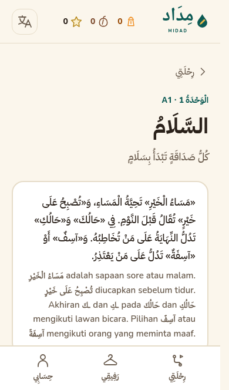
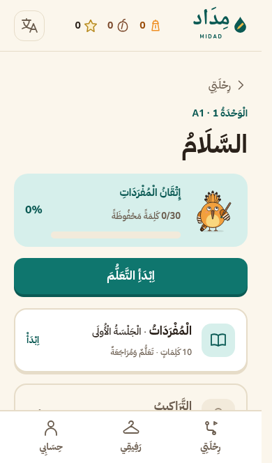
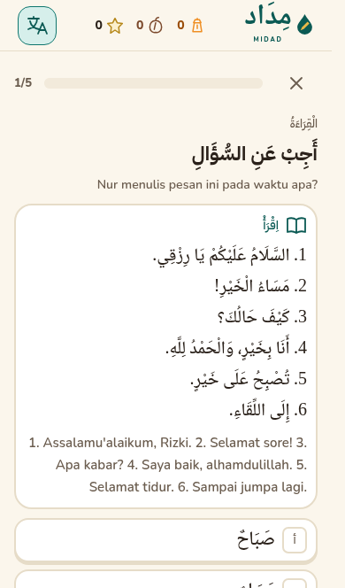
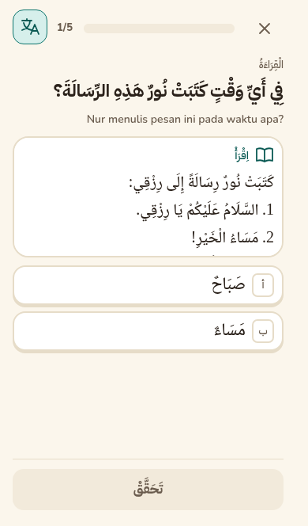
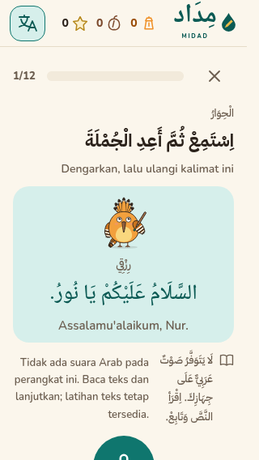
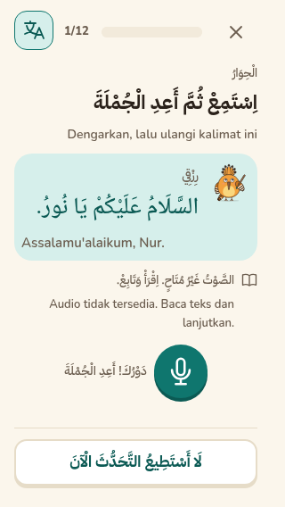
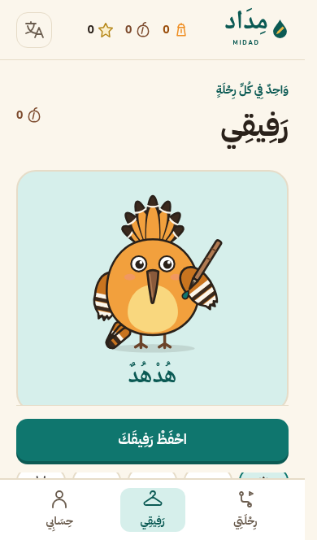
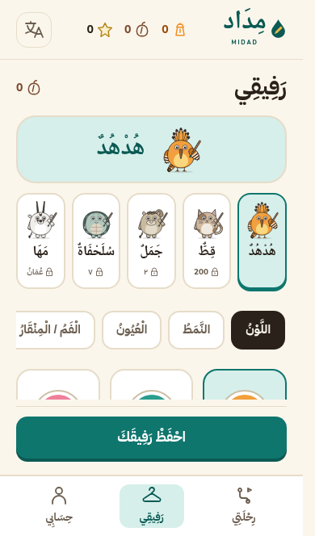

# Verifikasi demo Midad — 26 November 2026

Versi gabungan perbaikan konten, layar latihan, wahdah, dan maskot. Acuan audit menggunakan skill `audit-ai-design-slop` dan `no-ai-design-slop`, komponen Midad, serta pengukuran Mesurer 0.2.7. Seluruh browser audit berjalan headless.

## Hasil pemeriksaan

| Pemeriksaan | Hasil |
| --- | --- |
| Validasi aset, data, TypeScript, dan build produksi | Lulus |
| Tes domain | 39 lulus |
| Tes browser | 35 lulus, termasuk 15 skenario ukuran HP |
| Tes PWA produksi | 4 lulus |
| Viewport HP | 320×568, 360×640, 390×664 |
| Teks diperbesar | 200%, jawaban dan tombol tetap dapat dijangkau |

Ringkasan keluaran aktual tersedia di [build](build-result.txt), [unit](unit-result.txt), [browser](e2e-result.txt), [PWA](pwa-result.txt), dan [kode keluar proses](checks.json).

Alur browser dimulai dengan onboarding baru dan menyelesaikan semua kegiatan pada tiga wahdah Shaharil hingga ringkasan 93 entri. Pemeriksaan juga mencakup gagal kuis, hadiah berulang, checkpoint setelah reload, pengulangan kesalahan, izin mikrofon ditolak, hint, backup, impor, profil lama, tema, dan tes tahdid. Tes PWA memeriksa cache offline, globe, pergantian versi service worker, kegagalan registrasi, serta pemulihan progres.

## Bukti perbaikan

Koordinat diukur dari bagian atas viewport dalam piksel CSS. Tangkapan layar menunjukkan keadaan yang sama sejauh memungkinkan; versi setelah perbaikan memuat seluruh rangkaian PR.

| Masalah | Sebelum | Setelah |
| --- | --- | --- |
| Masuk wahdah, 390×664 | Catatan bahasa 295 px mendorong kegiatan pertama ke y=838 | Mulai belajar terlihat di y=370–422; tujuan dan catatan bisa dibuka |
| Qira'ah + terjemahan, 390×664 | Tombol Periksa di y=709–761 | Tombol di y=592–644; bacaan panjang memiliki area gulir |
| Hiwar + terjemahan, 320×568 | Tombol lewati di y=667–719 | Tombol di y=492–544; mikrofon terlihat |
| Pilihan jawaban, 320×568 | Tombol Periksa melewati batas bawah viewport | Empat pilihan dan tombol terlihat; tombol di y=496–548 |
| Maskot, 390×664 | Area Simpan menutupi pilihan hewan | Pratinjau 84 px; area pilihan, Simpan, dan navigasi mendapat ruang masing-masing |

### Wahdah

| Sebelum | Setelah |
| --- | --- |
|  |  |

### Qira'ah

| Sebelum | Setelah |
| --- | --- |
|  |  |

### Hiwar pada layar kecil

| Sebelum | Setelah |
| --- | --- |
|  |  |

### Maskot

| Sebelum | Setelah |
| --- | --- |
|  |  |

[Pilihan jawaban setelah perbaikan, 320×568](choice-after.png).

## Pengukuran Mesurer

Mesurer mengukur tombol Periksa sebesar **343×52 px** dan Simpan maskot **335×52 px** pada 390×664. Keduanya memakai IBM Plex Sans Arabic 17 px, bobot 700, padding 10×20 px, serta celah 8 px. Lihat [hasil inspeksi Periksa](reading-mesurer.png), [Simpan](wardrobe-mesurer.png), dan [teks pembacaan ekstensi](mesurer-readouts.json). Toolbar pada gambar inspeksi berasal dari ekstensi.

[Pengukuran DOM](measurements.json) mencatat 18 keadaan pada tiga ukuran HP. Pemeriksaan jangkauan tombol juga memakai hit test untuk memastikan kontrol dapat disentuh, termasuk sesudah teks diperbesar dan umpan balik dipulihkan.

Pengambilan gambar aplikasi dapat diulang dengan dev server aktif:

```sh
npm run dev
# Terminal lain, tetap headless:
node scripts/capture-mobile-audit.mjs test-results/design-audit
```

Skrip ini menyiapkan profil audit di browser terpisah. Pengukuran Mesurer dilakukan melalui ekstensi dan disimpan terpisah dari pengambilan gambar aplikasi.

## Integrasi PR

PR #1–#4 sebelumnya digabung ke cabang pendahulu. Cabang `main` baru memuat hasil #1. PR #5 menyatukan riwayat tersebut dan dukungan rekaman MP3 menjadi dasar perbaikan berikutnya.

| PR | Isi | Target |
| --- | --- | --- |
| [#5](https://github.com/ranupaners-arch/midad-app/pull/5) | Integrasi demo dan dukungan rekaman | main |
| [#6](https://github.com/ranupaners-arch/midad-app/pull/6) | Pertanyaan Arab lengkap | Cabang #5 |
| [#7](https://github.com/ranupaners-arch/midad-app/pull/7) | Area isi dan tindakan latihan | Cabang #6 |
| [#8](https://github.com/ranupaners-arch/midad-app/pull/8) | Wahdah, maskot, status globe | Cabang #7 |
| Verifikasi demo | Header latihan ringkas, pratinjau maskot lebih kecil, dan bukti QA | Cabang #8 |

Setelah disetujui, gabungkan PR verifikasi ke #8, lalu #8 ke #7, #7 ke #6, #6 ke #5, dan #5 ke `main`. Urutan ini membawa seluruh perubahan ke cabang rilis.

## Pekerjaan sebelum pengajuan

- [ ] Pengajar memeriksa harakat, nahwu, arti, konteks, dan kunci jawaban. Gunakan [lembar tinjauan qira'ah](tinjauan-konten.md).
- [ ] Penutur merekam dan meninjau audio untuk alur demo. File MP3 penutur belum disertakan.
- [ ] Uji HP fisik untuk sentuhan, alamat browser yang berubah tinggi, keyboard, audio, dan izin mikrofon. Emulasi viewport belum membuktikan hasil pada perangkat fisik.
- [ ] Uji dengan 5–10 calon pengguna dan catat hambatan yang benar-benar ditemukan.
- [ ] Integrasikan versi yang disetujui, deploy, dan periksa tautan dari perangkat lain tanpa akun pengembang.
- [ ] Siapkan video, PDF, ringkasan Arab, dan pernyataan orisinalitas sesuai [dokumen pengajuan proyek](../../notion/08-Konteks-Lomba-Timeline.md), lalu cocokkan dengan formulir lomba.

Daftar ini mencatat status teknis yang sudah diuji dan pekerjaan yang masih memerlukan pengajar, penutur, atau peserta uji. Versi ini belum dinyatakan siap diajukan.
