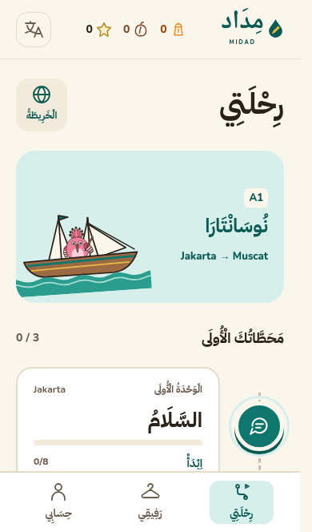
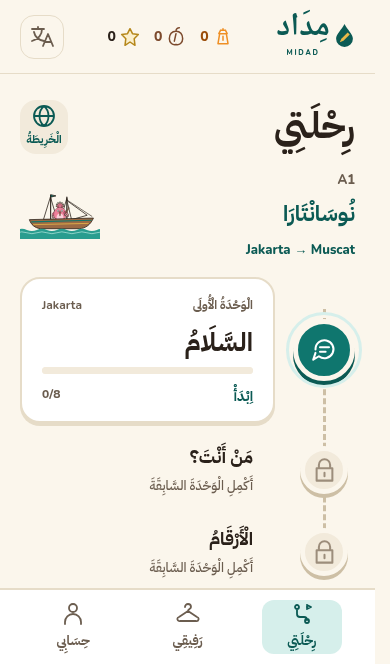
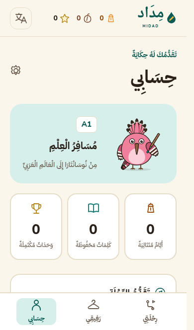
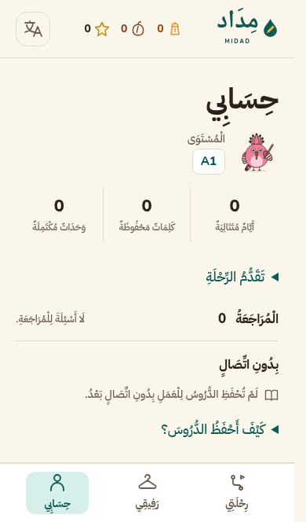

# Penyederhanaan beranda dan profil

Tinjauan lanjutan setelah umpan balik bahwa aplikasi masih terasa seperti template. Fokus perubahan adalah hierarki isi dan pengurangan elemen yang tidak membantu tindakan pengguna. Gambar pada 390×664 px.

| Beranda sebelum | Beranda sesudah |
| --- | --- |
|  |  |

| Profil sebelum | Profil sesudah |
| --- | --- |
|  |  |

- Banner kapal menjadi baris rute ringkas. Judul bagian berulang dan teaser wahdah keempat dihapus.
- Wahdah terkunci memakai baris yang lebih ringan. Navigasi mendapat ruang sendiri; beranda awal tidak memerlukan gulir halaman pada viewport yang ditampilkan. Progres lanjutan dan terjemahan dapat membuat isi beranda lebih panjang dan tetap bisa digulir di dalam area konten.
- Slogan profil dan julukan dekoratif dihapus. Statistik ditampilkan tanpa tiga kartu terpisah; pengaturan memakai pemisah antarbagian.
- Nilai per wahdah, penjelasan offline, aturan hint, informasi audio, dan versi aplikasi tersedia melalui bagian yang bisa dibuka. Status offline, kegagalan penyimpanan, pembaruan, dan tindakan backup tetap terlihat.
- Catatan audio dan penyimpanan mengikuti pengaturan terjemahan. Konfirmasi impor, reset, dan pesan kegagalan tetap memberi penjelasan langsung.
- Ringkasan akhir perjalanan tetap dapat dibuka langsung dari profil setelah tiga wahdah selesai.

Pemeriksaan visual dilakukan melalui browser headless terpisah dari jendela uji pengguna. Hasil tes fungsi dicatat pada deskripsi PR. Hasil tersebut tidak menggantikan penilaian visual pengguna.
