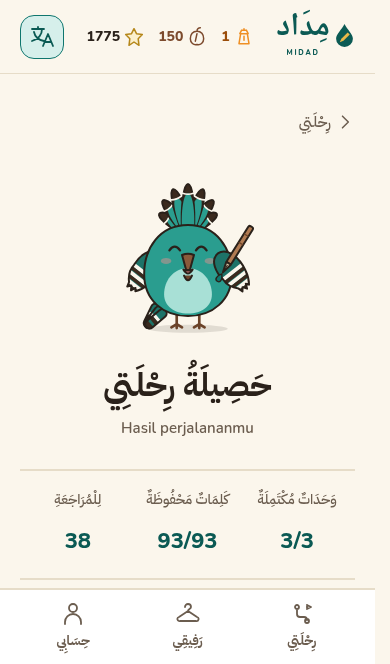
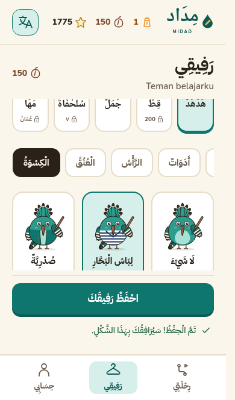

# Pengujian alur awal sampai akhir

Pengujian Chromium pada build produksi commit `75eee7e`, ukuran 390×664, dengan profil baru. Rekaman dijalankan pada 26 November dan hasilnya ditinjau pada 28 November 2026. Tidak ada progres pengguna yang dipakai atau diubah.

## Hasil fungsi

**7 skenario browser dan 4 skenario PWA lulus.** Alur utama menyelesaikan 498 langkah/soal melalui kontrol antarmuka, tanpa menulis progres langsung ke penyimpanan.

1. Layar awal → pilih bahasa → pilih warna hudhud → mulai A1.
2. Beranda → globe → Jakarta → wahdah pertama.
3. Ikuti tombol Lanjut melalui mufradat, susun kalimat, hiwar, qira'ah, latihan, serta kuis pada ketiga wahdah.
4. Jawab satu soal bacaan dengan salah dan muat ulang: umpan balik serta posisi soal pulih. Muat ulang di tengah mufradat juga mempertahankan posisi.
5. Selesaikan kuis dan buka wahdah selanjutnya hingga ringkasan akhir: **3/3 wahdah, 93/93 entri dikuasai, 150 kurma**, serta hadiah pelaut tersedia. Ringkasan tetap benar setelah reload; tidak ada error JavaScript yang tercatat.
6. Pakai hadiah pelaut melalui halaman maskot, simpan, dan muat ulang: skin tetap terpasang.
7. Kembali ke wahdah untuk membuka peti hiwar: mendapat 10 kurma sekali, sehingga total menjadi 160. Membuka peti lagi dan mengulang kuis tidak menambah hadiah lagi.

Skenario pendamping mencakup tes penempatan A1/A2, gagal kuis lalu mencoba kembali, backup/impor/reset, pemulihan umpan balik, serta pengenalan suara diterima/ditolak. Tes PWA mencakup pembukaan ulang secara offline, cache globe dan font, pergantian versi service worker, kegagalan registrasi, dan pemulihan ringkasan tanpa hadiah ganda.

## Temuan yang belum diperbaiki

| Dampak | Temuan | Bukti | Perbaikan yang disarankan |
| --- | --- | --- | --- |
| P1 | Pada hasil kuis, gambar, judul, dan skor mendorong tombol menuju wahdah selanjutnya ke bawah viewport. Pengguna harus menggulir untuk melanjutkan. | [Hasil kuis](hasil-kuis.png) | Ringkas bagian hasil dan sediakan area tombol yang tetap terjangkau. |
| P1 | Dialog peti terlalu tinggi pada ukuran uji. Tombol Coba dan Lanjut memerlukan gulir di dalam dialog. | [Dialog peti](peti-hiwar.png) | Ringkas ilustrasi dan salinan; pisahkan isi dialog yang bisa digulir dari tindakan. |
| P2 | Tombol Lanjut setelah hiwar langsung menuju mufradat berikutnya. Alur utama sampai ringkasan memiliki `chestRewards: {}`. Peti baru ditemukan setelah kembali ke halaman wahdah. | [Hasil terstruktur](results.json), `LessonResult` dan `UnitScreen` | Tampilkan tindakan mengambil hadiah setelah hiwar sebelum melanjutkan. |

## Batas pengujian

- Di Chrome, layar awal langsung menampilkan pilihan bahasa. Belum ada splash screen terpisah pada kode aplikasi web. [Layar awal](awal.png).
- Pada alur lengkap, 37 bagian bicara dilewati melalui jalur tanpa mikrofon dan disimpan untuk pengulangan. Ditambah satu soal bacaan yang sengaja salah, ringkasan menampilkan **38 bagian untuk diulang**. Keberhasilan serta penolakan pengenalan suara diuji terpisah menggunakan stub, sehingga hasil ini belum membuktikan mikrofon atau pelafalan nyata.
- Rekaman penutur belum disertakan. Pengujian ini tidak memverifikasi kualitas audio dan materi pengajar.
- Kelulusan tes fungsi tidak menyatakan temuan tata letak di atas sudah selesai.

## Bukti akhir

| Ringkasan | Hadiah dipakai |
| --- | --- |
|  |  |

[Data hasil pengujian](results.json).

Laporan interaktif, 24 tangkapan layar, rekaman video, dan trace tersimpan secara lokal di `test-results/workflow-report/` dan `test-results/workflow-audit/`. Folder tersebut diabaikan Git agar rekaman tidak memperbesar repositori.

Pengujian dapat diulang dengan:

```sh
node node_modules/playwright/cli.js install ffmpeg
npm run test:workflow
npm run test:pwa
```
